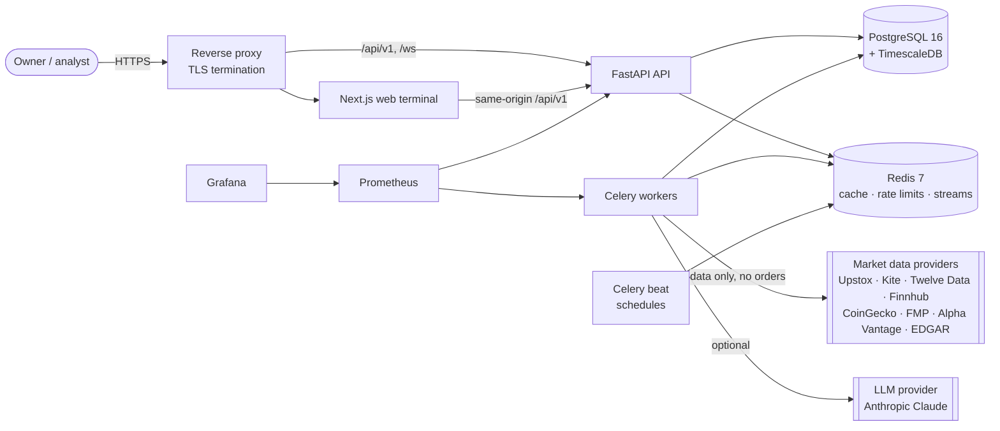
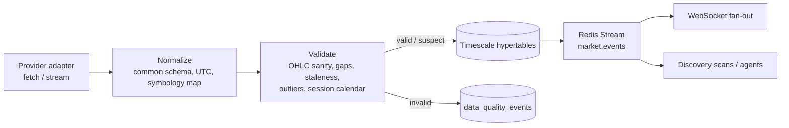
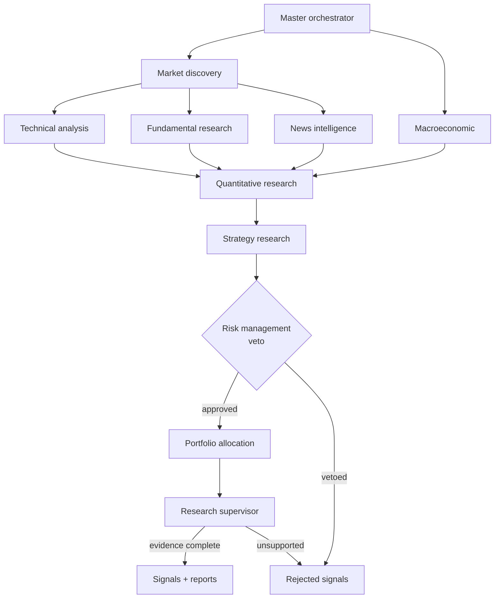

# AetherTrade AI — Architecture

This document is the reference for how the system is put together and **why**. When the code and this
document disagree, fix one of them in the same change.

## 1. System context



There is **no edge from any component to a broker order API**. Broker integrations are data-only.

## 2. Deployment shape: a modular monolith

One Python codebase (`backend/app`) runs as three process types:

| Process | Entrypoint | Responsibility |
| --- | --- | --- |
| `api` | `uvicorn app.main:app` | REST + WebSocket API, authentication, request validation |
| `worker` | `celery -A app.workers worker` (Phase 2) | Ingestion, indicator computation, backtests, agent graphs, paper-trading ticks |
| `beat` | `celery -A app.workers beat` (Phase 2) | Schedules (market scans, end-of-day ingestion, daily briefing) |

Separate services are introduced only with a demonstrated need (e.g. a backtest farm saturating the
worker pool). Module boundaries below are drawn so that such a split is a deployment change, not a
rewrite.

## 3. Backend module map

```
backend/app/
├── main.py                 FastAPI application factory, middleware, exception handlers
├── cli.py                  Operational commands (create-owner, …)
├── core/                   config, logging, security (hashing, JWT), crypto (secret encryption),
│                           errors (RFC 9457), middleware, rate limiting, ids (UUIDv7), permissions
├── api/
│   ├── deps.py             Dependency injection: DB session, current user, permission checks
│   └── v1/                 Versioned routers; one module per endpoint group
├── database/
│   ├── base.py, session.py Declarative base, naming conventions, async engine/session factory
│   ├── models/             SQLAlchemy models (one module per domain)
│   ├── repositories/       Persistence; the only layer that issues SQL
│   └── migrations/         Alembic environment and revisions
├── identity/               Users, authentication, sessions (refresh-token families)
├── audit/                  Append-only audit log service
├── credentials/            Encrypted provider credentials (API key management)
├── providers/              Market data adapters behind a common protocol (Phase 2)
├── market_data/            ingestion → normalization → validation pipeline (Phase 2)
├── quant/                  Pure analytics kernels: indicators, analytics, regimes, portfolio (Phase 3)
├── strategies/             Strategy library, engine, optimization, versioning (Phase 3/6)
├── backtesting/            Event-driven engine, cost models, metrics, validation (Phase 3)
├── paper_trading/          Orders, fills, positions, ledger accounting (Phase 5)
├── risk/                   Risk engine and controls; owns the veto (Phase 5)
├── ai/                     LangGraph orchestrator, agents, LLM providers, prompts, schemas (Phase 4)
├── research/               News, fundamentals, macro, report assembly (Phase 4)
└── workers/                Celery app, scheduled jobs, tasks (Phase 2)
```

Deviation from the master prompt's layout, with reasons:

* `identity/`, `audit/`, `credentials/` are added as explicit domain modules — the prompt lists the
  capabilities (authentication, audit logging, API key management) but no home for them.
* Tests live in `backend/tests/` rather than `backend/app/tests/` so the production image and package do
  not ship test code.

### 3.1 Dependency rules

```
api  ──▶  application services (identity, credentials, backtesting, paper_trading, ai, …)
                │                         │
                ▼                         ▼
        repositories (SQL)        pure kernels (quant, backtesting.engine, risk.engine,
                │                  paper_trading.accounting) — no I/O, no globals
                ▼
           database models
```

* **Pure kernels** take plain data (arrays, dataclasses, Pydantic models) and return plain data. They
  never touch the database, network, clock or random state implicitly (clock and RNG seed are
  parameters). This is what makes "all financial calculations independently testable" true.
* **Services** orchestrate: load via repositories, call kernels, persist results, emit audit events.
* **Adapters** (providers, LLMs, Redis) implement `Protocol`s and are injected — tests use in-memory
  implementations, never network calls.
* Nothing outside `providers/` knows a provider's wire format; nothing outside `ai/providers/` knows an
  LLM vendor's SDK.

## 4. Cross-cutting policies

### 4.1 Numbers

| Kind of value | Python type | Database type | JSON wire format |
| --- | --- | --- | --- |
| Ledger money (cash, fees, P&L, capital) | `decimal.Decimal` | `NUMERIC(24, 8)` | string, e.g. `"100000.00000000"` |
| Prices, quantities in orders/fills/positions | `decimal.Decimal` | `NUMERIC(28, 10)` | string |
| Stored market data (OHLCV, quotes) | `Decimal` at ingestion | `NUMERIC(28, 10)` (exact provider values) | string |
| Research analytics (indicators, returns, statistics) | `numpy.float64` | `DOUBLE PRECISION` when stored | number |

The boundary is explicit: analytics kernels convert stored prices to `float64` for vectorised maths;
anything that changes a balance (paper fills, fees, P&L) is computed in `Decimal` with an explicit
rounding policy per currency. Floats never enter the ledger.

### 4.2 Time

* Every timestamp is stored as `TIMESTAMPTZ` in **UTC**; Python code uses timezone-aware `datetime`
  only (naive datetimes are rejected at schema boundaries).
* Exchange-local time is used only for session calendars (e.g. NSE 09:15–15:30 Asia/Kolkata), and the
  exchange's IANA timezone is stored on the `exchanges` row.
* Candle timestamps are the **bucket start** in UTC; the timeframe is stored alongside, so a bar's close
  time is derivable and never confused with its open.
* Two timestamps per market record: `event_ts` (when it happened at the source) and `ingested_at`
  (when we received it). Staleness = `now − event_ts`, evaluated against per-feed thresholds.

### 4.3 Data provenance

Every market data record carries:

| Field | Values |
| --- | --- |
| `provider` | e.g. `upstox`, `twelve_data`, `fixture` |
| `data_mode` | `live`, `delayed`, `historical`, `fixture` |
| `quality` | `valid`, `suspect`, `invalid` (with `data_quality_events` explaining why) |
| `event_ts`, `ingested_at` | UTC |
| instrument, exchange, asset class, currency, timeframe | normalized identifiers |

Rules: a query never silently unions providers, exchanges, currencies or contract months — the caller
names them, or a documented reconciliation step chooses and records the choice. `fixture` data is only
loadable when `AETHER_ALLOW_FIXTURE_DATA=true` and is rendered with a distinct **FIXTURE** badge.

### 4.4 Point-in-time correctness

* Fundamentals, corporate actions, news and macro observations store `available_at` (when the
  information became public) separately from the period they describe. Backtests filter on
  `available_at <= decision_time`.
* Raw prices are stored unadjusted; split/bonus/dividend adjustments are applied at query time from
  `corporate_actions` as known at the decision time.
* Delisted instruments are retained (`delisted_at`) and included in historical universes to prevent
  survivorship bias.
* Macro series keep vintages (revisions are new rows, not updates).

### 4.5 Reproducibility and immutability

* `strategy_versions` are immutable once `validated` (enforced by a database trigger, not only code).
  Any change creates a new version with `parent_version_id`.
* A `backtest_run` records the strategy version, dataset fingerprint (SHA-256 over the exact candles
  used), cost-model version, engine version and random seed.
* `audit_logs` are append-only (UPDATE/DELETE/TRUNCATE blocked by triggers — implemented in Phase 1).
* Every paper order references the signal, strategy version, risk decision and market-data record it was
  priced from, so every simulated trade is traceable.

## 5. Market data pipeline (Phase 2)



* `providers/base.py` defines `MarketDataProvider` with capability declarations (asset classes,
  exchanges, timeframes, live vs delayed, historical depth). The registry routes a request only to a
  provider that **declares** the capability; there is no "best effort" fallback to another market.
* Adapters expose **no order placement**. A test asserts no adapter defines order methods.
* Provider health checks run on a schedule; status, latency and last error are stored and shown in
  Settings.
* Missing credentials → the adapter reports `not_configured`. Development fixtures are a separate
  `fixture` provider, never a silent substitute.

## 6. Quantitative engine (Phase 3)

* **Indicators** (`quant/indicators`): our own NumPy implementations are the reference; TA-Lib is used
  for speed where it matches the reference within tolerance (tests compare both). Warm-up periods yield
  `NaN`, never back-filled values.
* **Backtesting** (`backtesting/engine`): an event-driven engine is the system of record. Signals are
  computed on bar close and filled at the **next** bar's open by default; same-bar fills require an
  explicit, documented assumption. Fills are constrained by bar range and a participation cap of bar
  volume. Costs come from **versioned, effective-dated cost models** per exchange/product (brokerage,
  STT/CTT, exchange transaction charges, SEBI fees, stamp duty, GST, spread, slippage) whose parameters
  are data with source references — not constants in code.
* VectorBT may be used for fast vectorised parameter sweeps; any candidate it finds is re-run in the
  event-driven engine before its metrics are recorded. Backtrader may serve as an independent oracle in
  tests. Both are evaluated for Python 3.13 support at the start of Phase 3.
* **Validation**: in-sample / out-of-sample split, anchored and rolling walk-forward, purged k-fold with
  embargo for ML, Monte Carlo bootstrap of trades and returns, deflated Sharpe ratio, probability of
  backtest overfitting (CSCV).

## 7. AI multi-agent research (Phase 4)

### 7.1 Principle

> Code computes. The LLM explains, classifies and drafts — from evidence it is given — and its output is
> validated before anything uses it.

### 7.2 Graph



* Implemented with LangGraph `StateGraph`; the state is a typed Pydantic model. Each agent is a node
  with a declared input slice, output schema and version.
* Each agent = deterministic **tools** (indicator kernels, backtests, repositories) + optional LLM step
  for synthesis/classification. The LLM receives tool outputs as data and must reference them by
  **evidence ID**; it cannot introduce a number that is not present in the evidence (checked by the
  supervisor's numeric-claim validator).
* Outputs are Pydantic models; invalid output → one bounded repair attempt → otherwise the agent run
  fails and is logged. Partial graph failure yields a report that states what is missing.
* `NO_TRADE` is a first-class output of strategy research, risk and supervision.
* Risk veto is enforced twice: as a graph node, and again inside the paper-trading service, which
  refuses any order without an approving `risk_decisions` row.

### 7.3 LLM provider abstraction

`ai/providers/base.py` defines `LLMProvider.generate_structured(messages, output_schema, budget)`.
Implementations: `anthropic` (optional) and `disabled` (returns a typed "LLM disabled" result so the
deterministic parts of the graph still run and the UI says so). Model, prompt version and token usage
are recorded on every agent run.

### 7.4 Prompt-injection and tool safety

* News, filings and web content are **untrusted**. They are passed only to classification/extraction
  calls that have **no tools**, inside clearly delimited data blocks, and their outputs are validated
  against strict schemas (enums, bounded strings).
* Agents call only allow-listed, read-only tools with typed arguments. No agent can execute generated
  code, read environment variables, read `provider_credentials`, or create orders directly.
* Per-run budgets: tokens, wall-clock, tool calls. All agent runs, prompts (hashed + versioned) and
  outputs are persisted for audit.

## 8. Paper trading (Phase 5)

* Order lifecycle: `pending_risk → open → partially_filled → filled | cancelled | expired | rejected`.
* Fill simulation uses the market data the order references: market orders at next available
  quote/bar with spread and slippage; limit orders only when price **trades through** the limit
  (conservative); stops trigger on traded price. Liquidity cap per bar.
* Cash is a ledger (`ledger_entries`); balances are derived, never edited. Multi-currency positions
  convert through point-in-time FX rates, recorded on the entry.
* Contract specifications (lot size, tick size, multiplier, expiry) come from the instrument registry
  as of the trade date.
* Strategy tournaments: N portfolios, identical capital, identical market-data stream and period, one
  strategy version each; compared on the same metrics.

## 9. Security architecture

| Concern | Implementation (Phase 1 unless noted) |
| --- | --- |
| Authentication | Argon2id password hashes; short-lived JWT access token (HS256) + opaque, hashed, rotating refresh tokens grouped in families with reuse detection; `token_version` on users invalidates all access tokens on password change. A rotated token presented again within 10 s is treated as a multi-tab race (`401 session-rotated`, cookies left intact so the browser keeps the winner's fresh session); later reuse revokes the whole family. |
| Browser session | Tokens in `HttpOnly`, `SameSite=Strict` cookies (`Secure` outside development); state-changing cookie-authenticated requests must carry `X-Requested-With: aethertrade` (CSRF defence in depth). |
| API clients | `Authorization: Bearer` via `/api/v1/auth/token` (OAuth2 password form). |
| Authorization | Role → permission map (`owner`, `analyst`, `viewer`); endpoints declare required permissions. |
| Secrets at rest | Provider API keys encrypted with Fernet (AES-128-CBC + HMAC-SHA256) under `MultiFernet` for key rotation; keys from environment, never the database; API returns only a hint (last 4 chars). |
| Rate limiting | Redis fixed-window limits (atomic `SET NX EX` + `INCR`) on login/token/refresh: attempts per IP, failures per (account, IP), and failures per account across all IPs so that varying the apparent client IP cannot enable unlimited guessing. Keys hold a hash of the email, never the email. In-memory backend allowed only outside production. |
| Client IP / proxy headers | `X-Forwarded-For` is not trusted (uvicorn's default). A spoofable client IP would undermine IP-keyed limits, so trust is configured only for an exact reverse-proxy address (Phase 7). |
| Audit | Append-only `audit_logs` for authentication events, credential changes, preference changes; later for strategy validation, orders, agent decisions. |
| Transport | TLS at the reverse proxy (Phase 7); HSTS when `cookie_secure`; security headers on every response. |
| Configuration | Production refuses to start with default/weak JWT secret, missing encryption key, insecure cookies, debug on, or in-memory rate limiting. |
| Containers | Implemented: non-root users (UID 10001), root-owned application files, read-only root filesystem for the API, `no-new-privileges`, ports bound to 127.0.0.1, optional build-time CA secret that never enters a layer. Phase 7: image scanning, resource limits, separate DB roles. |
| Logs | Structured JSON; a redaction processor masks passwords, tokens, secrets, API keys and `Authorization` values. |

## 10. Observability

* `structlog` JSON logs with `request_id` (propagated via `X-Request-ID`) on every line.
* Prometheus metrics endpoint (Phase 7; request latency, ingestion lag, data-quality failure counts,
  agent run durations and failures, Celery queue depth). Grafana dashboards are provisioned from
  `infrastructure/monitoring`.
* Health: `/api/v1/system/health/live` (process up) and `/api/v1/system/health/ready` (database and
  Redis reachable).

## 11. Frontend architecture

* **Next.js App Router** with route groups: `app/login` (public) and `app/(terminal)/…` (authenticated
  shell). `proxy.ts` (Next 16's request proxy, formerly middleware) redirects unauthenticated page
  requests to `/login` based on a session-hint cookie; the backend remains the authority.
* Browser → Next.js → FastAPI via a same-origin rewrite of `/api/v1/*`, so cookies stay first-party and
  no CORS is needed. WebSockets (Phase 2) go through the reverse proxy.
* **Server state**: TanStack Query, one query-key factory per domain. **UI state**: Zustand (sidebar,
  command palette, layout preferences). No server data in Zustand.
* **Design system**: tokens as CSS variables (dark-first, light supported), Tailwind v4 `@theme`,
  shadcn/ui-pattern components in `components/ui`, domain components per feature folder. Numbers use
  tabular monospace figures and Indian digit grouping where the base currency is INR.
* **Data honesty contract**: every component that renders market or performance data takes a
  `dataMode` and renders a `DataModeBadge`; panels without a data source render an explicit empty state
  naming the phase that delivers it. There is no "demo data" mode.

## 12. Architecture decision records

| ADR | Decision |
| --- | --- |
| 0001 | Build in `aethertrade-ai/`, leave the existing poster app untouched. |
| 0002 | Modular monolith; one codebase, three process types. |
| 0003 | TimescaleDB is required (initial migration creates the extension) — no plain-Postgres mode. |
| 0004 | Decimal for ledger/prices, float64 for analytics, decimals as JSON strings. |
| 0005 | Event-driven backtester is the system of record; vectorised libraries are accelerators. |
| 0006 | Cookie-based browser auth behind a same-origin rewrite; bearer tokens for API clients. |
| 0007 | LLM never produces numbers; evidence IDs mandatory; supervisor validates. |
| 0008 | Broker adapters are data-only; live execution is not in the codebase. |
