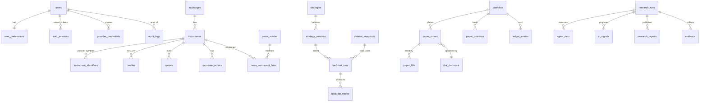

# AetherTrade AI — Database Design

PostgreSQL 16 + TimescaleDB 2.x. Migrations: Alembic (`backend/app/database/migrations`).
Tables marked **✅ Phase 1** exist now; everything else is the target design and will be refined when
its phase is implemented (each change lands as a new Alembic revision — revisions are never edited
after merge).

## 1. Conventions

| Topic | Rule |
| --- | --- |
| Primary keys | `UUID`. Generated application-side as **UUIDv7** (time-ordered → B-tree locality for high-insert tables). Hypertables use composite natural keys instead. |
| Timestamps | `TIMESTAMPTZ`, stored in UTC; `created_at` / `updated_at` on mutable entities. |
| Money | `NUMERIC(24, 8)`. Prices and quantities `NUMERIC(28, 10)`. Never `REAL`/`DOUBLE` for ledger values. |
| Analytics values | `DOUBLE PRECISION` (indicator outputs, statistics) — documented per column. |
| Enumerations | `TEXT` + `CHECK (col IN (...))` rather than native enums, so adding a value is a cheap migration. |
| Naming | `snake_case`; constraint names follow the SQLAlchemy naming convention in `database/base.py` (`pk_`, `fk_`, `uq_`, `ck_`, `ix_`). |
| Foreign keys | Always indexed. `ON DELETE RESTRICT` by default; `CASCADE` only for pure child rows (e.g. preferences). |
| Soft deletion | Research and trading history is never deleted; entities use `archived_at` / `revoked_at` / `retired`. |
| JSONB | For versioned, schema-validated payloads (parameters, configs, agent outputs). Each JSONB column has a Pydantic schema and a `*_schema_version` where it evolves. |
| Immutability | Enforced with triggers where it matters (audit logs, validated strategy versions, fills, ledger). |

## 2. Entity overview

## 3. Identity, configuration and audit — ✅ Phase 1

### `users`
| Column | Type | Notes |
| --- | --- | --- |
| id | UUID PK | |
| email | TEXT UNIQUE NOT NULL | `CHECK (email = lower(email))` — normalized by the service |
| password_hash | TEXT NOT NULL | Argon2id (PHC string) |
| display_name | TEXT NOT NULL | |
| role | TEXT NOT NULL | `owner`, `analyst`, `viewer` |
| is_active | BOOLEAN NOT NULL DEFAULT true | |
| token_version | INTEGER NOT NULL DEFAULT 0 | Embedded in access tokens; incrementing revokes all of them |
| last_login_at | TIMESTAMPTZ | |
| created_at, updated_at | TIMESTAMPTZ NOT NULL | |

### `user_preferences`
| Column | Type | Notes |
| --- | --- | --- |
| user_id | UUID PK, FK → users ON DELETE CASCADE | |
| base_currency | CHAR(3) NOT NULL DEFAULT 'INR' | ISO 4217, `CHECK` against supported set |
| timezone | TEXT NOT NULL DEFAULT 'Asia/Kolkata' | IANA name, validated by the service |
| number_locale | TEXT NOT NULL DEFAULT 'en-IN' | Digit grouping in the UI |
| theme | TEXT NOT NULL DEFAULT 'dark' | `dark`, `light`, `system` |
| default_paper_capital | NUMERIC(24,8) NOT NULL DEFAULT 100000 | `CHECK > 0`; product bounds (₹50,000–₹1,00,000) enforced by the service from configuration |
| updated_at | TIMESTAMPTZ NOT NULL | |

### `auth_sessions` (refresh tokens)
| Column | Type | Notes |
| --- | --- | --- |
| id | UUID PK | |
| user_id | UUID FK → users | indexed |
| family_id | UUID NOT NULL | All rotations of one login share a family; reuse of a rotated token revokes the family |
| token_hash | TEXT UNIQUE NOT NULL | SHA-256 of the opaque token — the token itself is never stored |
| issued_at, expires_at | TIMESTAMPTZ NOT NULL | |
| rotated_at, revoked_at | TIMESTAMPTZ | |
| revoked_reason | TEXT | `logout`, `rotated`, `reuse_detected`, `password_changed` |
| user_agent | TEXT | truncated to 512 chars |
| ip_address | INET | |

### `provider_credentials`
| Column | Type | Notes |
| --- | --- | --- |
| id | UUID PK | |
| provider | TEXT NOT NULL | Must exist in the provider catalog (`app/providers/catalog.py`) |
| label | TEXT NOT NULL | e.g. "primary" |
| encrypted_payload | BYTEA NOT NULL | Fernet token over a JSON object of secret fields |
| secret_fields | TEXT[] NOT NULL | Names only, for display |
| secret_hint | TEXT | Last 4 characters of the primary secret when it is ≥ 12 characters, else NULL |
| config | JSONB NOT NULL DEFAULT '{}' | Non-secret settings (e.g. redirect URI, SEC User-Agent) |
| created_by | UUID FK → users | |
| created_at, updated_at | TIMESTAMPTZ NOT NULL | |
| revoked_at | TIMESTAMPTZ | Revoked rows are kept for audit; payload is overwritten with an empty encrypted object on revoke |
| | | Partial unique index `(provider, label) WHERE revoked_at IS NULL` |

### `audit_logs` (append-only)
| Column | Type | Notes |
| --- | --- | --- |
| id | UUID PK | UUIDv7 → naturally time-ordered |
| occurred_at | TIMESTAMPTZ NOT NULL | indexed |
| actor_type | TEXT NOT NULL | `user`, `system`, `agent` |
| actor_id | UUID | user id or agent run id |
| action | TEXT NOT NULL | dotted verb, e.g. `auth.login.succeeded`, `credentials.created` |
| entity_type, entity_id | TEXT, UUID | |
| request_id | TEXT | correlates with logs |
| ip_address | INET | |
| details | JSONB NOT NULL DEFAULT '{}' | never contains secrets |

Triggers `audit_logs_block_update_delete` (row level) and `audit_logs_block_truncate` (statement
level) raise an exception. Tested.

## 4. Reference data — Phase 2

### `exchanges`
`id`, `code` (`NSE`, `BSE`, `NFO`, `MCX`, `CDS`, `NASDAQ`, `NYSE`, `CRYPTO:<venue>`, `FX:OTC`…) UNIQUE,
`mic` (ISO 10383, nullable), `name`, `country`, `timezone` (IANA), `currency`, `asset_classes TEXT[]`.

### `exchange_sessions`
`exchange_id`, `session_date`, `opens_at`, `closes_at` (UTC), `is_holiday`, `session_type`
(`regular`, `muhurat`, `special`), `source`, `source_url`. PK `(exchange_id, session_date, session_type)`.
Holiday calendars are loaded from exchange circulars, never inferred from missing data.

### `instruments`
| Column | Notes |
| --- | --- |
| id UUID PK | |
| exchange_id FK, symbol, asset_class | `asset_class ∈ equity, etf, index, future, option, forex, crypto, commodity` |
| currency CHAR(3), quote_currency CHAR(3) | quote currency for FX/crypto pairs |
| name, isin, sector, industry | |
| lot_size, tick_size, contract_multiplier | NUMERIC |
| underlying_id FK → instruments | derivatives |
| expiry DATE, strike NUMERIC(28,10), option_type (`CE`/`PE`), exercise_style, settlement (`cash`/`physical`) | derivatives |
| listed_at, delisted_at | survivorship-bias protection |
| is_active, metadata JSONB | |
| | UNIQUE `(exchange_id, symbol, expiry, strike, option_type)` with NULLs not distinct |

Contract specifications that change over time (NSE lot-size revisions) are versioned in
`instrument_contract_specs (instrument_id, effective_from, lot_size, tick_size, multiplier, source)`.

### `instrument_identifiers`
`instrument_id`, `provider`, `provider_symbol`, `provider_token`, `valid_from`, `valid_to`. Symbology
mapping per provider; one instrument can have several.

### `corporate_actions`
`id`, `instrument_id`, `action_type` (`split`, `bonus`, `dividend`, `rights`, `merger`, `demerger`,
`symbol_change`, `delisting`), `announced_at`, `available_at`, `ex_date`, `record_date`, `ratio_from`,
`ratio_to`, `cash_amount`, `currency`, `source`, `source_url`.

## 5. Market data (TimescaleDB hypertables) — Phase 2

### `candles`
| Column | Type |
| --- | --- |
| instrument_id | UUID NOT NULL |
| timeframe | TEXT NOT NULL (`1m`, `5m`, `15m`, `1h`, `1d`, `1w`) |
| bucket_start | TIMESTAMPTZ NOT NULL (UTC bucket start) |
| open, high, low, close | NUMERIC(28,10) NOT NULL, `CHECK (low <= open, close <= high, low <= high)` |
| volume | NUMERIC(28,10) |
| open_interest | NUMERIC(28,10) (derivatives) |
| provider | TEXT NOT NULL |
| data_mode | TEXT NOT NULL (`live`, `delayed`, `historical`, `fixture`) |
| quality | TEXT NOT NULL (`valid`, `suspect`, `invalid`) |
| is_adjusted | BOOLEAN NOT NULL DEFAULT false (raw is stored; adjusted series are derived) |
| ingested_at | TIMESTAMPTZ NOT NULL |

PK `(instrument_id, timeframe, provider, bucket_start)`; hypertable on `bucket_start` (7-day chunks for
intraday, 1-year for daily via separate tables or chunk sizing — decided in Phase 2 with real volumes);
compression after 30 days segmented by `(instrument_id, timeframe, provider)`. Continuous aggregates for
higher timeframes are only created from a single provider and data mode.

### `quotes`
`instrument_id`, `event_ts`, `bid`, `ask`, `last`, `bid_size`, `ask_size`, `volume`, `provider`,
`data_mode`, `quality`, `ingested_at`. Hypertable on `event_ts`, retention policy (e.g. 30 days raw).

### `option_chain_snapshots`
`underlying_id`, `instrument_id` (the option), `snapshot_ts`, `bid`, `ask`, `last`, `volume`,
`open_interest`, `implied_vol`, `delta`, `gamma`, `theta`, `vega`, `greeks_source` (`provider` or
`computed:<model>@<version>`), `provider`, `data_mode`. Hypertable on `snapshot_ts`.

### `data_quality_events`, `provider_health_checks`
Quality findings (`check`, `severity`, `details`, `detected_at`) and provider health history
(`status`, `latency_ms`, `error`, `checked_at`). Both hypertables.

## 6. Fundamentals, news and macro — Phase 4

* `fundamental_statements`: `instrument_id`, `statement_type` (`income`, `balance`, `cash_flow`),
  `period_type`, `period_end`, `fiscal_year`, `currency`, `data JSONB` (normalized line items),
  `reported_at`, `available_at`, `source`, `filing_url`, `is_restated`.
* `news_articles`: `id`, `source`, `url` UNIQUE, `title`, `summary`, `content_hash` (dedup),
  `dedup_cluster_id`, `published_at`, `fetched_at`, `language`, `event_type`, `sentiment_score`
  (DOUBLE), `sentiment_model_version`, `raw JSONB`. Content is untrusted input.
* `news_instrument_links`: `article_id`, `instrument_id`, `relevance` (DOUBLE), `extraction_method`
  (`symbol_match`, `ner`, `llm@<version>`). PK `(article_id, instrument_id)`.
* `macro_series` / `macro_observations`: observations keyed by `(series_id, period_date, vintage)` with
  `released_at`; revisions are new vintages.
* `economic_events`: scheduled releases with `scheduled_at`, `importance`, `actual`, `forecast`,
  `previous`, `source`.

## 7. Strategies, backtests and models — Phase 3 / 6

* `strategies`: `id`, `slug` UNIQUE, `name`, `category` (`technical`, `statistical`, `options`, `ml`),
  `description`, `created_at`, `archived_at`.
* `strategy_versions`: `id`, `strategy_id`, `version` (UNIQUE per strategy), `implementation`
  (registered class path), `implementation_version`, `parameters JSONB`, `parameters_hash`, `status`
  (`draft`, `backtested`, `validated`, `retired`), `parent_version_id`, `created_at`, `validated_at`,
  `validation_record JSONB`. **Trigger**: once `status = 'validated'`, only `status → retired` is
  allowed; parameters, implementation and validation record are frozen.
* `dataset_snapshots`: `id`, `fingerprint` (SHA-256) UNIQUE, `instrument_ids UUID[]`, `timeframe`,
  `start_ts`, `end_ts`, `providers TEXT[]`, `data_modes TEXT[]`, `row_count`, `created_at`.
* `cost_models`: `id`, `exchange`, `product` (`equity_delivery`, `equity_intraday`, `futures`, `options`,
  `currency`, `commodity`, `crypto_spot`, `us_equity`), `version`, `effective_from`, `effective_to`,
  `parameters JSONB`, `sources JSONB` (circular / URL per parameter).
* `backtest_runs`: `id`, `strategy_version_id`, `dataset_snapshot_id`, `cost_model_ids UUID[]`,
  `config JSONB` (capital, sizing, slippage model, fill assumptions), `split_role` (`in_sample`,
  `out_of_sample`, `walk_forward_train`, `walk_forward_test`, `full`), `walk_forward_group_id`,
  `engine_version`, `random_seed`, `status`, `started_at`, `finished_at`, `error`.
* `backtest_trades`, `backtest_equity_points` (hypertable): per-trade and per-bar results.
* `performance_metrics`: `subject_type` (`backtest_run`, `portfolio`, `strategy_version`), `subject_id`,
  `period_start`, `period_end`, `metric_set_version`, typed columns for the headline metrics
  (`net_return`, `cagr`, `sharpe`, `sortino`, `calmar`, `max_drawdown`, `win_rate`, `profit_factor`,
  `expectancy`, `recovery_factor`, `trade_count`) plus `extra JSONB`.
* `optimization_runs`: `strategy_id`, `search_space JSONB`, `method`, `objective`, `n_trials`,
  `train/test windows`, `deflated_sharpe`, `pbo`, `best_version_id`, `status`.
* `monte_carlo_runs`: `subject_type`, `subject_id`, `method` (`trade_bootstrap`, `block_bootstrap`,
  `parametric`), `n_paths`, `horizon`, `seed`, `assumptions JSONB`, `results JSONB` (percentiles,
  probabilities).
* `model_registry`: `name`, `version`, `model_type`, `artifact_uri`, `artifact_sha256`,
  `training_dataset_snapshot_id`, `feature_set JSONB`, `hyperparameters JSONB`, `cv_scheme`,
  `metrics JSONB`, `baseline_metrics JSONB`, `status` (`experimental`, `candidate`, `approved`,
  `retired`), `created_at`.

## 8. Paper trading and risk — Phase 5

* `portfolios`: `id`, `owner_id`, `name`, `kind` (`manual`, `strategy`, `tournament`), `base_currency`,
  `initial_capital NUMERIC(24,8)`, `strategy_version_id`, `tournament_id`, `status`, `created_at`,
  `closed_at`.
* `ledger_entries` (append-only): `id`, `portfolio_id`, `occurred_at`, `entry_type` (`deposit`,
  `withdrawal`, `trade_debit`, `trade_credit`, `fee`, `tax`, `dividend`, `fx_conversion`), `currency`,
  `amount NUMERIC(24,8)` (signed), `fx_rate`, `reference_type`, `reference_id`. Virtual balances are
  `SUM(amount)` per portfolio/currency (materialized in `portfolio_balances`, maintained in the same
  transaction and reconciled by a test).
* `risk_limits`: versioned per portfolio (`max_position_pct`, `max_gross_exposure`, `max_daily_loss`,
  `max_drawdown`, `max_correlated_exposure`, `min_liquidity`, …).
* `risk_decisions`: `id`, `subject_type`, `subject_id`, `approved`, `checks JSONB` (rule, observed,
  limit, passed), `risk_limits_version`, `decided_by` (`risk_engine@<version>` / agent run),
  `decided_at`.
* `paper_orders`: `id`, `portfolio_id`, `instrument_id`, `side`, `order_type` (`market`, `limit`,
  `stop`, `stop_limit`), `quantity`, `limit_price`, `stop_price`, `time_in_force`, `status`,
  `risk_decision_id` (NOT NULL for any order beyond `pending_risk`), `signal_id`, `strategy_version_id`,
  `idempotency_key` UNIQUE, `created_at`, `updated_at`.
* `paper_fills` (append-only): `id`, `order_id`, `filled_at`, `quantity`, `price`, `fees JSONB`,
  `slippage`, `market_data_ref JSONB` (provider, data_mode, instrument, event_ts / bucket_start).
* `paper_positions`: `portfolio_id`, `instrument_id`, `quantity`, `average_price`, `realized_pnl`,
  `stop_loss`, `take_profit`, `opened_at`, `closed_at`.
* `portfolio_snapshots` (hypertable): `portfolio_id`, `ts`, `equity`, `cash`, `gross_exposure`,
  `net_exposure`, `drawdown`, `data_mode`.
* `tournaments`, `tournament_entries`.

## 9. AI research — Phase 4

* `research_runs`: `id`, `trigger` (`schedule`, `manual`), `graph_version`, `universe JSONB`, `status`,
  `started_at`, `finished_at`, `budget JSONB`, `usage JSONB`.
* `agent_runs`: `id`, `research_run_id`, `agent_name`, `agent_version`, `status`, `input_ref JSONB`,
  `output JSONB`, `output_schema_version`, `llm_provider`, `model`, `prompt_version`, `prompt_hash`,
  `tokens_in`, `tokens_out`, `started_at`, `finished_at`, `error`.
* `agent_events` (hypertable): fine-grained execution log per agent run (`ts`, `level`, `event`,
  `data JSONB`).
* `evidence`: `id`, `research_run_id`, `kind` (`indicator`, `backtest_metric`, `news_article`,
  `filing`, `macro_observation`, `quote`), `source_table`, `source_id`, `value JSONB`, `captured_at`,
  `content_hash`.
* `ai_signals`: `id`, `research_run_id`, `instrument_id`, `direction` (`long`, `short`, `no_trade`),
  `horizon`, `entry`, `stop`, `target`, `score` (model-derived, not LLM-stated), `status` (`proposed`,
  `supervisor_rejected`, `risk_rejected`, `approved`, `expired`), `rejection_reasons JSONB`,
  `evidence_ids UUID[]`, `strategy_version_id`, `created_at`, `expires_at`.
* `research_reports`: `id`, `research_run_id`, `report_type` (`daily_briefing`, `instrument`,
  `strategy`, `market`), `title`, `body_markdown`, `structured JSONB`, `evidence_ids UUID[]`,
  `supervisor_verdict JSONB`, `published_at`.

## 10. Watchlists and notifications — Phase 2

* `watchlists` (`id`, `user_id`, `name`, `position`), `watchlist_items` (`watchlist_id`,
  `instrument_id`, `added_at`, `note`).
* `notifications` (`id`, `user_id`, `kind`, `payload JSONB`, `created_at`, `read_at`).

## 11. Operations

* **Backups** (Phase 7): nightly `pg_dump` (custom format) + WAL archiving for point-in-time recovery;
  restore is tested in CI on a schedule.
* **Roles**: the application connects as `aether_app` (DML only); migrations run as `aether_migrator`
  (DDL). Phase 1 uses a single role in development; the split lands with Phase 7 hardening.
* **Retention**: raw quotes 30 days; candles indefinitely; agent events 180 days; audit logs indefinitely.
