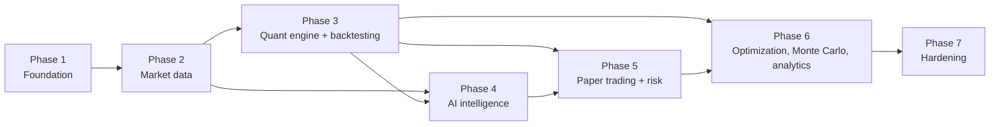

# AetherTrade AI — Development Roadmap

**Definition of done (every task):** the underlying functionality works, inputs and outputs are
validated, failures are handled and surfaced, tests exist and pass in CI, and documentation is updated.
A screen alone is never "done".

Priority: **P0** blocks the phase · **P1** required to close the phase · **P2** valuable, may slip.
Status: ✅ done · 🟡 partial · ⬜ not started.

## Implementation dependencies

Critical path: instrument registry → candles → indicators → backtest engine → cost models →
validation protocol → risk engine → paper trading. AI agents consume these as tools, so they come after
the deterministic layer they depend on — an agent with nothing trustworthy to call can only hallucinate.

---

## Phase 0 — Inspection and architecture ✅

| # | Task | Status |
| --- | --- | --- |
| 0.1 | Inspect repository; record findings (unrelated Expo app at root → isolate in `aethertrade-ai/`) | ✅ |
| 0.2 | Architecture, database design, API specification, project plan, roadmap | ✅ |
| 0.3 | Regulatory notes and provider evaluation template | ✅ |
| 0.4 | Permanent project skill (`SKILL.md`, linked into `.claude/skills/`) | ✅ |

## Phase 1 — Foundation ✅

| # | P | Task | Acceptance criteria | Status |
| --- | --- | --- | --- | --- |
| 1.1 | P0 | Backend project (uv, FastAPI app factory, ruff, mypy strict, pytest) | `uv run pytest`, `ruff check`, `mypy` clean | ✅ |
| 1.2 | P0 | Configuration management (pydantic-settings) | Typed settings; production refuses insecure configuration (tested) | ✅ also verified in the API container |
| 1.3 | P0 | Structured logging with request IDs and secret redaction | Redaction unit-tested | ✅ |
| 1.4 | P0 | Database layer: async SQLAlchemy, naming conventions, UUIDv7, UTC timestamps | Session lifecycle tested against TimescaleDB | ✅ |
| 1.5 | P0 | Alembic initial migration: timescaledb extension, users, preferences, auth sessions, credentials, audit logs | Upgrade → downgrade → upgrade test passes; models match migrations | ✅ |
| 1.6 | P0 | Authentication: Argon2id, JWT access, rotating refresh families with reuse detection, cookies + bearer | API tests for login, refresh, rotation reuse, logout, token-version revocation | ✅ incl. multi-tab refresh race |
| 1.7 | P0 | Authorization: role → permission map, endpoint dependencies | API tests for forbidden paths | ✅ |
| 1.8 | P0 | Rate limiting (Redis; in-memory only outside production) | Login lockout tested; Redis backend tested against real Redis | ✅ per IP, per (account, IP), per account across all IPs |
| 1.9 | P0 | Append-only audit log (DB triggers) | Update/delete/truncate rejected (tested) | ✅ |
| 1.10 | P1 | Encrypted provider credentials + provider catalog | Round-trip encryption, key rotation, API never returns secrets (tested) | ✅ |
| 1.11 | P1 | Health/readiness and system info endpoints | Tested with dependencies up and down | ✅ |
| 1.12 | P1 | `create-user` CLI (no unauthenticated sign-up) | Tested | ✅ |
| 1.13 | P0 | Frontend: Next.js + TypeScript + Tailwind v4, design tokens, shadcn-pattern UI primitives | Lint, type-check, unit tests, production build pass | ✅ |
| 1.14 | P0 | Application shell: sidebar with all 18 modules, top bar, status strip, mobile drawer, command palette | Every nav entry resolves to a page (tested) | ✅ |
| 1.15 | P0 | Login/logout flow, session refresh, route protection | E2E: login → dashboard → logout | ✅ |
| 1.16 | P1 | Settings: preferences, API integrations (encrypted keys), system health, password change, audit log | E2E: add and revoke a credential | ✅ |
| 1.17 | P1 | Honest module pages: each unimplemented module shows scope and the phase that delivers it — no placeholder numbers | Unit tests check registry completeness and that planned pages render no figures | ✅ |
| 1.18 | P1 | Infrastructure: docker-compose (TimescaleDB, Redis, API, web), Dockerfiles, `.env.example` | `docker compose up` brings the stack to healthy | ✅ stack healthy; E2E suite passed against it |
| 1.19 | P1 | CI workflow: backend + frontend jobs | Workflow committed and green | 🟡 committed; first GitHub run pending |

### Known limitations and follow-ups from Phase 1

| Item | Impact | Planned resolution |
| --- | --- | --- |
| Proxy headers are not trusted, so behind the web container every request appears to come from the web container's IP. | Per-IP limits apply to all browser traffic together and the audit log records the container IP. Brute force stays bounded by the per-account limits, which do not depend on IP. | Phase 7: TLS reverse proxy with an exact `FORWARDED_ALLOW_IPS` trust. |
| CSP allows inline scripts (`'unsafe-inline'`), required by Next.js bootstrap scripts without nonces. | Weaker XSS mitigation than a nonce-based CSP. | Phase 7: nonce-based CSP via `proxy.ts`. |
| Refresh-token families have a sliding 14-day expiry but no absolute maximum session age. | A continuously refreshed session never ends on its own (reuse detection still applies). | Phase 7 security review: add an absolute family lifetime. |
| End-to-end tests are not in CI (they need a running stack). | E2E regressions are only caught locally. | Add a compose-based E2E job once CI is green. |
| The Next.js rewrite target (`AETHER_BACKEND_URL`) is baked in at build time in standalone output. | Changing the API address requires rebuilding the web image. | Revisit when the Phase 7 reverse proxy routes `/api` directly. |
| ESLint is pinned to 9.x: the plugins bundled by `eslint-config-next` 16.4.6 do not yet declare ESLint 10 support. | npm reports ESLint 9 as no longer supported (dev tooling only). | Upgrade when `eslint-config-next` supports ESLint 10. |
| No Prometheus metrics yet; logs only. | Limited operational visibility. | Phase 7. |

## Phase 2 — Market data

| # | P | Task |
| --- | --- | --- |
| 2.1 | P0 | **Provider due diligence**: for each candidate provider, read the official docs and record endpoints, markets, timeframes, historical depth, live vs delayed, rate limits, subscription cost and storage/redistribution terms in `docs/providers/PROVIDER_EVALUATION.md`, with links and the date verified |
| 2.2 | P0 | `MarketDataProvider` protocol with capability declarations; provider registry that routes only to declared capabilities; data-only (test asserts no order methods) |
| 2.3 | P0 | Instrument registry + exchanges + sessions/holiday calendars (from exchange sources) + symbology mapping |
| 2.4 | P0 | Candles and quotes hypertables, compression and retention policies |
| 2.5 | P0 | Normalization (UTC, symbology, decimals) and validation pipeline (OHLC sanity, gaps vs calendar, staleness, outliers) with `data_quality_events` |
| 2.6 | P0 | First adapters (order decided by 2.1 — likely one Indian broker feed, CoinGecko for crypto, one global provider), each with health checks, retry/backoff, rate-limit budgeting and recorded-response tests |
| 2.7 | P1 | Clearly labelled `fixture` provider for development (disabled by default, FIXTURE badge everywhere) |
| 2.8 | P1 | Celery worker + beat; scheduled end-of-day and intraday ingestion; Redis Streams events |
| 2.9 | P1 | WebSocket gateway (quotes, notifications) |
| 2.10 | P1 | Market pages wired to real data: Global, India, F&O (contract browser), Forex, Crypto, Commodities, US, ETFs — with data-mode badges and staleness |
| 2.11 | P1 | Watchlists (API + UI) |
| 2.12 | P2 | Corporate actions ingestion and adjusted-series derivation |

## Phase 3 — Quantitative engine

| # | P | Task |
| --- | --- | --- |
| 3.1 | P0 | Indicator kernels (RSI, MACD, EMA, SMA, VWAP, ATR, Bollinger, ADX, Fibonacci, OBV/volume, support/resistance, candlestick patterns) with reference tests; TA-Lib parity tests |
| 3.2 | P0 | Event-driven backtest engine: next-bar fills, stops/targets, sizing, liquidity cap, missing data, holidays, expiry/rollover |
| 3.3 | P0 | Versioned cost models (Indian equity delivery/intraday, F&O, currency, commodity; US equity; crypto) with sourced parameters |
| 3.4 | P0 | Metrics library (net return, CAGR, Sharpe, Sortino, Calmar, max DD, win rate, profit factor, expectancy, recovery factor) with reference tests |
| 3.5 | P0 | Strategy library v1 (EMA crossover, RSI divergence, MACD momentum, VWAP breakout, Bollinger squeeze, S/R breakout, ATR trend) + immutable strategy versions |
| 3.6 | P0 | Look-ahead guard tests (future data injected → results unchanged) |
| 3.7 | P1 | In-sample/out-of-sample, walk-forward, Monte Carlo bootstrap |
| 3.8 | P1 | Market analytics + regime detection (volatility/trend regimes) |
| 3.9 | P1 | Statistical strategies (mean reversion, pairs with cointegration tests, momentum ranking, volatility expansion) |
| 3.10 | P1 | Strategy Laboratory + Backtesting UI on real results (TradingView Lightweight Charts) |
| 3.11 | P2 | Options strategies (covered call, protective put, spreads, iron condor) — requires option chain history; scope confirmed by 2.1 findings |

## Phase 4 — AI intelligence

| # | P | Task |
| --- | --- | --- |
| 4.1 | P0 | LLM provider abstraction (`anthropic`, `disabled`), structured output validation with bounded repair |
| 4.2 | P0 | Evidence store and numeric-claim validator |
| 4.3 | P0 | LangGraph orchestrator with typed state, budgets, failure handling, persisted agent runs/events |
| 4.4 | P0 | Agents: discovery, technical, quantitative, strategy research, risk (veto), supervisor |
| 4.5 | P1 | News ingestion, dedup, entity linking, event classification, sentiment (untrusted-input pipeline) |
| 4.6 | P1 | Fundamental agent (point-in-time statements; EDGAR for US, exchange filings for India) |
| 4.7 | P1 | Macro agent (RBI, Fed, CPI, calendars) |
| 4.8 | P1 | Portfolio allocation agent |
| 4.9 | P1 | AI Intelligence Center, News & Events, Research Reports pages |
| 4.10 | P0 | Prompt-injection test suite (malicious news content must not change tool calls or outputs) |

## Phase 5 — Paper trading

| # | P | Task |
| --- | --- | --- |
| 5.1 | P0 | Portfolios, ledger, balances (Decimal, reconciled) |
| 5.2 | P0 | Order state machine, fill simulator (market/limit/stop, spread, slippage, liquidity), idempotency |
| 5.3 | P0 | Risk engine + limits + mandatory risk decision on every order |
| 5.4 | P0 | Positions, realized/unrealized P&L, multi-currency via point-in-time FX |
| 5.5 | P1 | Strategy portfolios driven by signals; strategy tournaments on identical data |
| 5.6 | P1 | Paper Portfolio page, trade journal, equity curve, drawdown |

## Phase 6 — Optimization and analytics

| # | P | Task |
| --- | --- | --- |
| 6.1 | P0 | Parameter optimization with trial accounting, deflated Sharpe, PBO |
| 6.2 | P0 | Return projection engine: contributions, compounding, costs, taxes (effective-dated rules), Monte Carlo percentiles (5/25/50/75/95), P(loss), P(drawdown > x), P(target) — four scenarios |
| 6.3 | P1 | Performance Analytics page; portfolio risk (VaR/CVaR, correlation, concentration) |
| 6.4 | P1 | Automated daily briefing report |
| 6.5 | P2 | ML strategies (RF, XGBoost, gradient boosting, regime classifier) with purged CV and baseline comparison |

## Phase 7 — Production hardening

| # | P | Task |
| --- | --- | --- |
| 7.1 | P0 | Prometheus metrics, Grafana dashboards, alerting |
| 7.2 | P0 | Security review (OWASP ASVS L2 checklist), dependency scanning, secret scanning |
| 7.3 | P0 | TLS reverse proxy, separated DB roles, container hardening |
| 7.4 | P0 | Backups, WAL archiving, tested restore |
| 7.5 | P1 | Load and soak tests for ingestion and WebSockets |
| 7.6 | P1 | Runbooks and full documentation pass |
